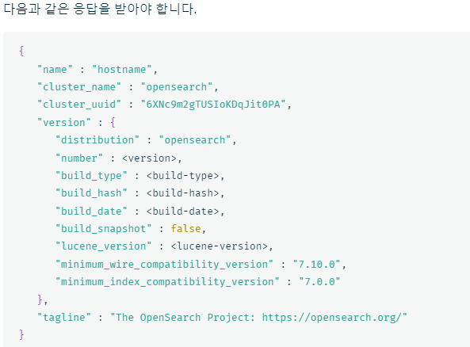

# opensearch

\#opensearch 설치

```
[opensearch]
#설치
sudo curl -SL https://artifacts.opensearch.org/releases/bundle/opensearch/2.x/opensearch-2.x.repo -o /etc/yum.repos.d/opensearch-2.x.repo
sudo yum clean all
sudo yum repolist
sudo yum list opensearch --showduplicates
sudo yum install 'opensearch-2.12.0' -> 원하는 버전 선택
sudo systemctl start opensearch
sudo systemctl status opensearch

#포트  9200 응답확인
curl -X GET https://localhost:9200 -u 'admin:<custom-admin-password>' --insecure

#플러그인 엔드포인트 쿼리
curl -X GET https://localhost:9200/_cat/plugins?v -u 'admin:<custom-admin-password>' --insecure
```

<figure><figcaption><p>포트 9200 응답확인</p></figcaption></figure>

<figure><figcaption><p>플러그인 엔드포인트 응답확인</p></figcaption></figure>


\#사용자 환경에 opensearch 설정

```
sudo vi /etc/opensearch/opensearch.yml

다음 줄 추가
# Bind OpenSearch to the correct network interface. Use 0.0.0.0
# to include all available interfaces or specify an IP address
# assigned to a specific interface.
network.host: 0.0.0.0

# Unless you have already configured a cluster, you should set
# discovery.type to single-node, or the bootstrap checks will
# fail when you try to start the service.
discovery.type: single-node

# If you previously disabled the Security plugin in opensearch.yml,
# be sure to re-enable it. Otherwise you can skip this setting.
plugins.security.disabled: false
```
